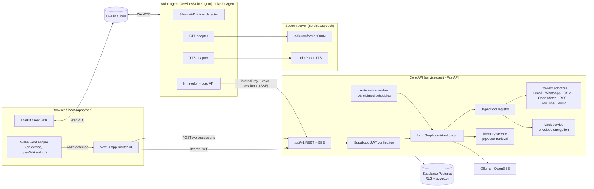
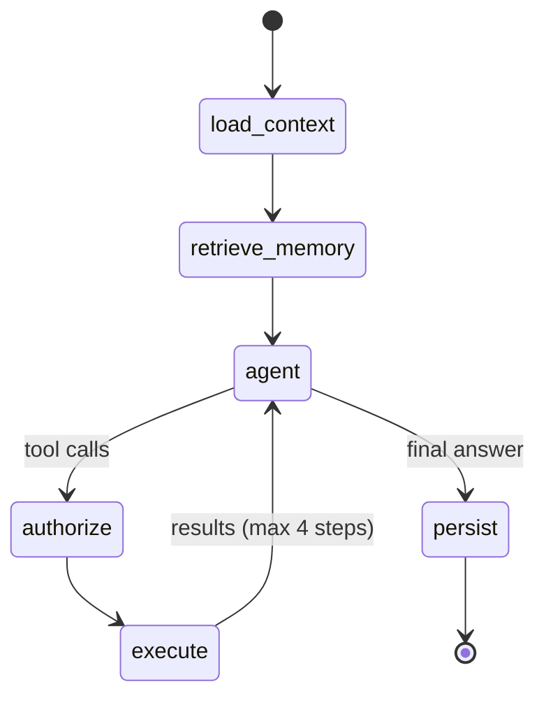

# Nexora architecture

Nexora is a personal AI assistant with text and real-time voice. Every request, from text or voice,
goes through **one** assistant graph (LangGraph) in the core API. The core API applies the same
authorization, approval and tool rules to both.

## System overview

## Responsibilities

| Component | Owns | Never does |
| --- | --- | --- |
| `apps/web` | UI, Supabase session, LiveKit client, on-device wake word, PWA | Holds service secrets, calls integrations directly |
| `services/api` | Auth verification, user data, permissions, approvals, memory, vault, integrations, automations, assistant graph | Real-time audio |
| `services/voice-agent` | LiveKit room sessions, VAD, turn detection, interruption, STT/TTS adapters | Tool logic or integrations. It calls the core API for every turn. |
| `services/speech` | Loading and serving the IndicConformer and Parler-TTS models (warm, reused) | Any user data |
| Supabase | Postgres, Auth, Storage, RLS, pgvector | - |

## Request flows

### Text turn

1. The browser sends `POST /api/v1/assistant/runs` with the Supabase access token.
2. The API verifies the JWT (JWKS, or HS256 for the legacy secret), loads the profile and starts a
   **run**: an asyncio task that is decoupled from the HTTP connection.
3. The run executes the graph and appends events to a per-run event buffer.
4. The browser streams `GET /api/v1/assistant/runs/{id}/events` (SSE). It sends `Last-Event-ID` when
   it reconnects, so a dropped connection resumes without losing tokens. `POST .../cancel` stops
   generation.
5. The final assistant message is persisted even if the client disconnected.

### Voice turn

1. A push-to-talk press or a detected wake word calls `POST /api/v1/voice/sessions`. The API creates
   a `voice_sessions` row and returns a **10-minute LiveKit token**. The token is bound to a private
   room (`nxr-<session id>`) and carries an explicit agent dispatch whose metadata holds the
   session id.
2. The voice agent joins and reads the dispatch metadata. For each finished user turn it calls
   `POST /api/v1/internal/voice/turns` with the internal service key, the session id, the room name
   and the participant identity. The API checks that the session is active, that the room matches
   and that the identity is the session owner. Only then does it run **the same graph** with
   `channel="voice"`, which asks for short spoken answers.
3. Barge-in: LiveKit's VAD-based interruption cancels TTS playback. The agent also cancels the
   in-flight HTTP stream, so the API run is cancelled too.

### Wake word

The wake word engine runs entirely in the browser. openWakeWord models run with ONNX Runtime Web in
a Web Worker on 16 kHz audio from the local microphone (an AudioWorklet captures it). Until it fires, **no audio leaves the device**, and Nexora only
connects to LiveKit after detection. The engine has a sensitivity threshold and a cooldown, and it
can be disabled. Push-to-talk always works. A PWA cannot listen while the phone is locked or the
tab is suspended (see `docs/voice.md`).

## Assistant graph (LangGraph)

* **load_context**: the last N messages of the conversation the user owns, plus preferences
  (language, response style, memory settings).
* **retrieve_memory**: top-k memories by vector similarity, only when memory is enabled.
* **agent**: one LLM call with typed tool schemas, streaming tokens. If no LLM is reachable, a
  deterministic **offline intent router** maps clear requests (weather, news, nearby...) to tools
  and answers with templates. The UI labels this mode, so it is never presented as an AI answer.
* **authorize**: validates the arguments against the tool's Pydantic model and checks the tool
  permission and the integration connection. Approval-required tools (send email, send WhatsApp,
  reveal secret...) become `approvals` rows instead of executing.
* **execute**: runs the tool with a timeout and validates the result.
* **persist**: stores the assistant message and tool trace. Memories are only saved through the
  explicit `memory_save` tool, or through auto-extraction when the user enables it.

Tools can only reach explicit provider adapters. The assistant has no shell, no arbitrary HTTP, no
SQL and no code execution.

## Data and security

* Supabase Auth is the identity source. The API trusts only verified JWTs (`aud=authenticated`).
* Every table the API reads is filtered by `user_id` in repositories. RLS (`auth.uid() = user_id`)
  also protects any direct PostgREST access. Approvals and audit logs have no client write
  policies.
* Vault and OAuth tokens use **envelope encryption**: a per-item AES-256-GCM data key, wrapped by a
  versioned master key (local keyring in dev, AWS KMS in production). The associated data binds
  each ciphertext to its user, record and purpose. See `docs/security.md`.
* LiveKit tokens are short-lived and room-scoped, and only the API can mint them.

## Provider abstractions

| Concern | Interface | Implementations |
| --- | --- | --- |
| LLM | `app/llm/base.py:LLMProvider` | Ollama (Qwen3 8B), OpenAI-compatible cloud fallback, offline router |
| Embeddings | `app/memory/embeddings.py` | Ollama embeddings, deterministic hashing (dev/test, lexical only) |
| Places | `app/integrations/maps` | Nominatim + Overpass (configurable endpoints) |
| Weather | `app/integrations/weather` | Open-Meteo |
| News | `app/integrations/news` | RSS feeds |
| Music | `app/integrations/music` | iTunes Search API, Spotify Web API |
| STT | voice-agent `providers/stt` | IndicConformer (speech server), LiveKit Inference fallback |
| TTS | voice-agent `providers/tts` | Indic Parler-TTS (speech server), LiveKit Inference fallback |
| Key management | `app/vault/encryption.py:KeyProvider` | Local keyring, AWS KMS |
| Wake word | web `lib/voice/wake-word` | openWakeWord models on ONNX Runtime Web |

## Local development without external services

| Missing | Behaviour |
| --- | --- |
| Supabase | SQLite database and a dev-only login (`AUTH_DEV_MODE=true`, refused when `APP_ENV=production`) |
| Ollama | Offline intent router; the UI shows an "offline mode" badge |
| LiveKit | Voice controls are disabled with an explanation |
| Speech server | The voice agent uses the configured LiveKit Inference fallback, or refuses to start |
| Gmail / WhatsApp / YouTube / Spotify | Integration shows "Not configured" with setup steps |
